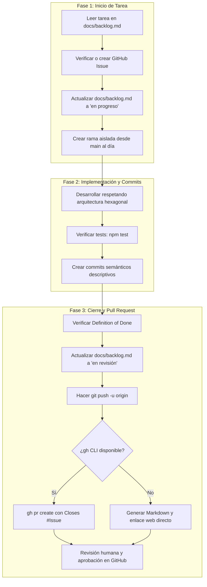

# Flujo de Trabajo Git, Backlog e Issues

Esta skill estandariza el ciclo de vida completo de cada tarea o funcionalidad en el repositorio, garantizando el cumplimiento de las reglas de [AGENTS.md](../../../AGENTS.md) y [docs/flujo-trabajo.md](../../../docs/flujo-trabajo.md).



---

## Fase 0: Creación de Issues y Tareas bajo demanda

Si el usuario pide registrar una nueva tarea, bug o mejora sin comenzar a programar de inmediato (por ejemplo: *"Creá un issue para agregar métricas de latencia"* o *"Registrá una tarea para probar WebSockets bajo desconexión"*):

1. **Definir título y criterio de aceptación:** Redactar de forma clara el objetivo y qué define que esté terminado.
2. **Registrar en `docs/backlog.md`:** Agregar la fila en la tabla con un ID representativo en estado `pendiente`.
3. **Crear el Issue en GitHub:**
   ```powershell
   gh issue create --title "[<ID>] <Título descriptivo>" --body "### Criterio de aceptación`n<Criterio>`n`nFuente: docs/backlog.md"
   ```
   *Nota: Gracias al workflow 'Auto-add to project', la tarjeta aparecerá automáticamente en la columna 'Backlog' del tablero sin necesidad de tocar la web.*
4. **Confirmar al usuario:** Informar el número de Issue creado y que ya está visible en el tablero.

---

## Fase 1: Iniciar Tarea

Cuando el usuario pida iniciar una tarea (por ejemplo: `DOM-005` o "resolver la carrera entre recálculo y confirmación"):

### 1. Localizar la tarea en `docs/backlog.md`
- Buscar el ID (`VIA-xxx`, `DOM-xxx`, `FLOT-xxx`, etc.).
- Identificar:
  - **Título/Trabajo**.
  - **Criterio de aceptación**.

### 2. Sincronizar o crear el GitHub Issue
- Si `gh` está disponible:
  ```powershell
  # Verificar si ya existe
  gh issue list --search "<ID_TAREA>" --state open
  ```
  Si no existe, crearlo con título y criterio:
  ```powershell
  gh issue create --title "[<ID>] <Título de la tarea>" --body "### Criterio de aceptación`n<Criterio de docs/backlog.md>`n`nFuente: docs/backlog.md"
  ```
  Anotar el número de issue asignado (ejemplo: `#15`).

### 3. Actualizar `docs/backlog.md`
- Cambiar el estado de la tarea de `pendiente` a `en progreso`.

### 4. Crear la rama correspondiente
- Asegurarse de estar en `main` actualizado:
  ```powershell
  git checkout main
  git pull origin main
  ```
- Crear la rama con un nombre claro y semántico: `feat/<slug>` o `fix/<slug>`:
  ```powershell
  git checkout -b feat/carrera-confirmacion-recalculo
  ```

---

## Fase 2: Implementación y Commits

Durante el desarrollo de la solución:

### 1. Respetar reglas arquitectónicas (AGENTS.md)
- **Aislamiento de Dominio:** Ningún archivo en `src/**/dominio.ts` debe importar `express`, `pg`, bases de datos ni dependencias de infraestructura externa.
- **Puertos y Adaptadores:** Toda integración externa entra por un puerto y cuenta con doble de prueba (en memoria / falso).
- **Configuración:** Toda variable de entorno debe validarse al inicio.
- **Idempotencia y Concurrencia:** Diseñar operaciones críticas para resistir llamadas simultáneas.

### 2. Validar pruebas antes de cada commit
- Ejecutar la suite:
  ```powershell
  npm.cmd test
  ```
  *(En PowerShell de Windows usar `npm.cmd test` para evitar bloqueos de ejecución de scripts).*
- Si alguna prueba falla, corregir antes de registrar el commit.

### 3. Commits semánticos y didácticos
- Crear commits frecuentes usando Conventional Commits (`feat:`, `fix:`, `test:`, `docs:`, `chore:`).
- El mensaje debe explicar el *qué* y el *por qué* de manera clara:
  ```powershell
  git commit -m "feat(viajes): asegurar verificacion atomica en confirmacion

- Bloquea el snapshot de precio al momento de confirmar
- Agrega test concurrente en viaje.test.ts
- Ref: DOM-005"
  ```

---

## Fase 3: Cierre y Pull Request

Al completar la funcionalidad:

### 1. Validar Definition of Done
Verificar que:
- El criterio de aceptación del backlog esté completamente cumplido.
- `npm test` pasa al 100%.
- Se actualizaron contratos (`docs/contratos.md`), modelo o ADR si la decisión lo requería.

### 2. Actualizar `docs/backlog.md`
- Cambiar el estado de la tarea a `en revisión`.
- Registrar un commit con el cambio:
  ```powershell
  git add docs/backlog.md
  git commit -m "docs: marcar <ID> en revision en backlog"
  ```

### 3. Subir la rama a GitHub
```powershell
git push -u origin <nombre-de-rama>
```

### 4. Crear el Pull Request
#### Caso A: Si `gh` está disponible
Crear el PR directamente vinculando el Issue con `Closes #Issue`:
```powershell
$prBody = @"
## 🎯 Tarea y Contexto
- **Backlog ID:** <ID>
- **Closes #<NumeroIssue>**
- **Criterio de aceptación:** <Criterio de docs/backlog.md>
- **ADR asociado:** <ADR si corresponde, ej. ADR 0033>

## 🛠️ Cambios introducidos
- <Resumen claro de archivos y lógica cambiada>

## 🧪 Cómo probar este PR
```powershell
npm test
```

## ✅ Checklist de Definition of Done
- [x] Arquitectura hexagonal respetada (dominio desacoplado).
- [x] Tests unitarios y de integración pasando.
- [x] Contratos y documentación sincronizados.
- [x] docs/backlog.md actualizado a 'en revisión'.
"@

gh pr create --title "<tipo>(<alcance>): <ID> <resumen>" --body $prBody
```

#### Caso B: Si `gh` no está disponible (Fallback)
Entregar al usuario en el chat:
1. El título exacto para el PR.
2. La descripción completa en formato Markdown (lista para copiar).
3. El enlace directo para abrir el formulario en GitHub:
   `https://github.com/FabioIgnacioNavarro/repo-appweb-viajes-grupo1/compare/<nombre-de-rama>?expand=1`

### 5. Ceder el paso a la revisión humana
Indicar en el chat que el PR fue publicado y que está listo para la **revisión de código y aprobación de merge** por parte de los compañeros de equipo.
