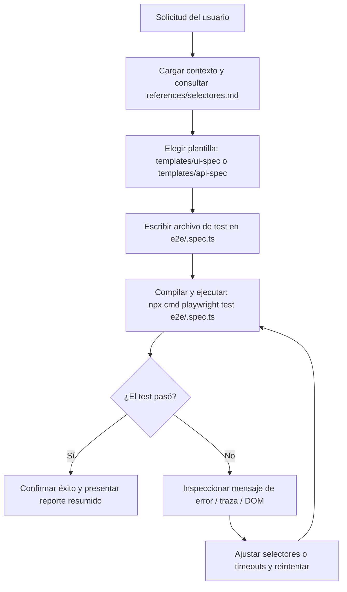

# Playwright Testing Skill

Esta skill define el estándar y el flujo de trabajo para generar pruebas automatizadas con **Playwright** en `repo-appweb-viajes-grupo1`, cubriendo tanto la interfaz web interactiva (`web/index.html`) como los contratos HTTP de la API backend.



---

## 1. Principios y Reglas de Calidad

1. **Prioridad de selectores:**
   - Preferir selectores semánticos y por rol: `page.getByRole('button', { name: /mostrar recorrido/i })`, `page.getByLabel('Latitud')`.
   - Si no hay rol claro, usar selectores por ID explícito: `#precio-estimado`, `#boton-avanzar` (consultar [references/selectores.md](references/selectores.md)).
   - **Prohibido:** Usar XPath complejos o selectores CSS frágiles dependientes del orden (`div > div:nth-child(3)`).

2. **Aserciones Web-First con auto-espera:**
   - Usar siempre `await expect(locator).toBeVisible()`, `await expect(locator).toHaveText(...)` o `await expect(locator).toBeEnabled()`.
   - **Prohibido:** Usar `page.waitForTimeout(ms)` fijo. Si una operación asíncrona (como cálculo de ruta o llamada a OSRM) tarda, configurar el timeout en la aserción: `await expect(locator).toBeVisible({ timeout: 10000 })`.

3. **Manejo de Autenticación y Cabeceras Backend:**
   - Toda solicitud que requiera autenticación debe enviar el encabezado `Authorization: Bearer <token>`.
   - Emplear los tokens de prueba documentados en `src/compartido/jwt-falso.ts` (ver [templates/api-spec.template.ts](templates/api-spec.template.ts)).
   - Las operaciones de creación como `POST /viajes` deben incluir la cabecera `Clave-Idempotencia: <uuid_o_string>`.

---

## 2. Tipos de Pruebas Admitidas

### A. Pruebas de Interfaz Web (`web/`)
Se ejecutan navegando a `"/"`. El servidor web de demostración arranca automáticamente según [playwright.config.ts](../../../playwright.config.ts) en el puerto `3000`.

- **Flujo típico:**
  1. Cargar la página inicial y verificar el estado `"Sin iniciar"`.
  2. Completar coordenadas o usar las precargadas y enviar el formulario `#formulario-ruta`.
  3. Esperar que se reciba el precio estimado y la vigencia.
  4. Presionar `#boton-avanzar` para avanzar por los estados: `Solicitado` -> `Asignado` -> `En curso` -> `Finalizado`.

### B. Pruebas de API / Integración HTTP
Utilizan la fixture `{ request }` de Playwright para validar contratos sin renderizar navegador.

- **Flujo típico:**
  1. Envío de payloads JSON a endpoints como `/demostracion/estimaciones` o `/viajes/estimacion`.
  2. Validación de códigos HTTP (`200`, `201`, `400`, `401`, `409`, `503`).
  3. Validación de estructura de respuesta e invariantes de negocio.

---

## 3. Protocolo de Ejecución en Windows

En este entorno (PowerShell en Windows), siempre invocar Playwright a través de `npx.cmd`:

```powershell
# Ejecutar un archivo de test específico
npx.cmd playwright test e2e/<nombre>.spec.ts

# Ejecutar todos los tests de Playwright
npx.cmd playwright test

# Ejecutar con salida detallada
npx.cmd playwright test --reporter=list
```

> **Nota:** La configuración utiliza el canal nativo `chrome` de Windows para evitar descargas adicionales y garantizar velocidad.

---

## 4. Ciclo de Auto-Reparación ante Fallos

Si un test generado falla durante la ejecución:

1. **Revisar el error:** Leer el locator que falló o el código de respuesta HTTP inesperado.
2. **Inspeccionar el DOM o el contrato:** Verificar si el texto del botón cambió o si el elemento estaba deshabilitado al hacer clic.
3. **Corregir el archivo del test:** Modificar el selector o agregar `expect(...).toBeEnabled()` previo al click.
4. **Re-ejecutar:** Correr nuevamente el comando `npx.cmd playwright test <archivo>` hasta obtener el resultado en verde antes de entregar la tarea al usuario.
