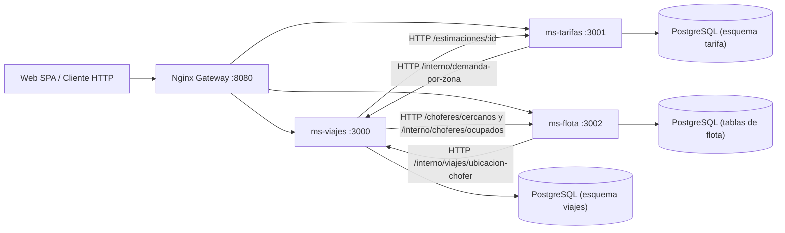

# Guía de Demostración — Tema 4: Monolito modular y microservicios

Esta guía documenta la arquitectura de microservicios del sistema y los pasos reproducibles para demostrar cómo están separados `ms-viajes`, `ms-tarifas` y `ms-flota`, qué costos introduce esa separación frente a un monolito modular y cómo reacciona el sistema ante la caída controlada de un servicio.

---

## 1. Arquitectura implementada y fronteras de datos

El proyecto adopta **tres microservicios independientes en Node.js 22 / TypeScript** detrás de un gateway Nginx, manteniendo internamente **arquitectura hexagonal** en cada servicio ([ADR 0016](adr/0016-microservicios-y-autenticacion-externa.md)):



### Separación por servicio

| Servicio | Puerto interno | Responsabilidad principal | Almacenamiento propio | Contratos que expone |
|---|---|---|---|---|
| `ms-viajes` | `3000` | Ciclo de vida del viaje, ofertas, asignación atómica, idempotencia, cobros y WebSocket | Esquema `viajes` (`src/ms-viajes/schema.sql`) | `/viajes*`, `/choferes/yo/ofertas*`, `/tiempo-real`, `/interno/demanda-por-zona`, `/interno/viajes/ubicacion-chofer` |
| `ms-tarifas` | `3001` | Reglas de tarifa dinámica versionadas, cálculo de precios, rutas y geocodificación | Esquema `tarifa` (`src/ms-tarifas/schema.sql`) | `/viajes/estimacion`, `/reglas/demanda`, `/tarifas/geocodificacion-inversa`, `/estimaciones/:id` |
| `ms-flota` | `3002` | Habilitación/disponibilidad de choferes, geolocalización en tiempo real y cercanía | Tablas `usuario_chofer`, `ubicacion_actual`, `ubicacion_historica` (`src/ms-flota/schema.sql`) | `/choferes/yo/*`, `/choferes/cercanos`, `/interno/choferes/ocupados` |

### Regla de aislamiento
- Ningún microservicio importa código de dominio ni adaptadores SQL de otro microservicio.
- Ningún microservicio ejecuta SQL ni define claves foráneas sobre las tablas de otro (`scripts/verificar-arquitectura.mjs` verifica los límites hexagonales internos en `npm run lint:arquitectura`).
- La comunicación entre servicios ocurre únicamente mediante adaptadores HTTP (`src/compartido/cliente-servicios.ts`), propagando `Authorization: Bearer` y encabezados de traza W3C `traceparent` ([ADR 0030](adr/0030-integracion-http-entre-servicios.md)).

---

## 2. Cuándo conviene separar y qué costos introduce

### Por qué se separó en tres servicios
1. **Patrones de carga y escritura muy distintos:** `ms-flota` procesa ráfagas frecuentes de coordenadas GPS de choferes (`PATCH /choferes/yo/ubicacion`), `ms-tarifas` integra APIs externas de rutas/clima/geocodificación y reglas dinámicas, y `ms-viajes` concentra las transacciones críticas de asignación única de chofer y cobros.
2. **Aislamiento de fallas de proveedores externos:** un timeout o saturación en Google Maps / OSRM / Nominatim queda acotado en `ms-tarifas` sin bloquear el seguimiento GPS de `ms-flota` ni el avance de viajes en curso en `ms-viajes`.
3. **Contratos explícitos y desarrollo paralelo:** cada integrante pudo desarrollar y probar su servicio detrás de interfaces HTTP documentadas en [docs/api.md](api.md).

### Costos asumidos frente a un monolito modular
- **Fallas parciales y red ([ADR 0022](adr/0022-fallas-dependencias-entre-servicios.md), [ADR 0023](adr/0023-timeouts-reintentos-servicios.md)):** las llamadas entre servicios ya no son invocaciones en memoria; requieren `TIMEOUT_SERVICIO_MS` (`1500 ms`), `REINTENTOS_SERVICIO` (`1`) acotado y fallo cerrado `503 DEPENDENCIA_NO_DISPONIBLE`.
- **Consistencia distribuida ([ADR 0030](adr/0030-integracion-http-entre-servicios.md), [ADR 0035](adr/0035-cobro-simulado-recuperable.md)):** sin transacciones SQL compartidas entre módulos, las operaciones entre servicios exigen claves de idempotencia y tolerancia a recuperaciones parciales (por ejemplo, liberar/ocupar choferes vía HTTP o reintentar cobros).
- **Observabilidad y operación:** exige propagar `traceparent` entre procesos ([docs/demo-observabilidad.md](demo-observabilidad.md)), exponer `/ready` por contenedor y orquestar múltiples servicios y salud en [docker-compose.yml](../docker-compose.yml) y [nginx.conf](../nginx.conf).

---

## 3. Demostración práctica reproducible

### Paso 1: Verificar aislamiento modular sin red (tests unitarios y análisis estático)

Gracias a la arquitectura hexagonal, cada dominio puede probarse en un solo proceso con puertos en memoria sin levantar red ni contenedores:

```powershell
npm.cmd run lint:arquitectura
npm.cmd test
```

En `tests/ms-viajes/fallas-dependencias.test.ts` se ejecutan además pruebas automatizadas que simulan caídas, timeouts y recuperaciones entre `ms-viajes`, `ms-flota` y `ms-tarifas` verificando el código `503 DEPENDENCIA_NO_DISPONIBLE` y la consistencia con `Clave-Idempotencia`.

### Paso 2: Verificar los servicios separados en Docker Compose

Levantar todo el sistema distribuido y comprobar que los tres microservicios están listos detrás del gateway:

```powershell
docker compose up -d --wait
curl.exe -s http://localhost:8080/ready/viajes
curl.exe -s http://localhost:8080/ready/tarifas
curl.exe -s http://localhost:8080/ready/flota
```

Los tres endpoints deben responder `200` con `estado: "listo"`.

### Paso 3: Provocar la caída controlada de un microservicio (`ms-flota` o `ms-tarifas`)

Detener únicamente `ms-flota` para observar qué sigue funcionando y qué operaciones fallan de forma controlada:

```powershell
docker compose stop ms-flota
```

1. **Aislamiento de disponibilidad:**
   - `curl.exe -i http://localhost:8080/ready/flota` devuelve `502` desde Nginx porque `ms-flota` está caído.
   - `curl.exe -i http://localhost:8080/ready/viajes` y `curl.exe -i http://localhost:8080/ready/tarifas` siguen respondiendo `200` (el sistema no cae completo).
2. **Impacto en operaciones dependientes:**
   - Al consultar reglas o historial de viajes en `ms-viajes` / `ms-tarifas`, esos endpoints siguen operativos.
   - Al intentar confirmar un viaje nuevo (`POST /viajes`, que necesita candidatos de `ms-flota`) o calcular una estimación que dependa de disponibilidad, `ms-viajes` agota el timeout + reintento configurado y responde **`503 DEPENDENCIA_NO_DISPONIBLE`** sin crear viajes corruptos ni asignaciones inconsistentes.
3. **Recuperación:**
   ```powershell
   docker compose start ms-flota
   curl.exe -s http://localhost:8080/ready/flota
   ```
   Una vez restablecido `ms-flota`, el pasajero puede reintentar `POST /viajes` reutilizando la misma `Clave-Idempotencia` y completar el flujo con normalidad.

---

## 4. Referencias relacionadas
- [ADR 0016 — Microservicios con autenticación externa](adr/0016-microservicios-y-autenticacion-externa.md)
- [ADR 0022 — Fallas de dependencias entre servicios](adr/0022-fallas-dependencias-entre-servicios.md)
- [ADR 0023 — Timeouts y reintentos entre servicios](adr/0023-timeouts-reintentos-servicios.md)
- [ADR 0024 — Nginx como gateway](adr/0024-nginx-gateway.md)
- [ADR 0030 — Integración HTTP entre servicios](adr/0030-integracion-http-entre-servicios.md)
- [tests/ms-viajes/fallas-dependencias.test.ts](../tests/ms-viajes/fallas-dependencias.test.ts)
