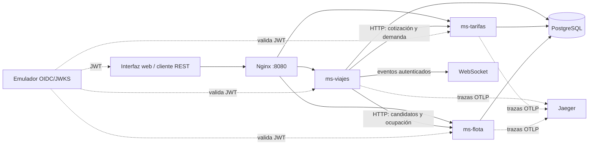

# Informe técnico — Plataforma de viajes, Programación IV

**Grupo:** 1 — Echeverria, Borchichi y Navarro  
**Estado de este informe:** corte documental del 18 de noviembre de 2026. Las cifras y pruebas se vinculan a sus registros; no se presentan como una certificación de producción.

## 1. Resumen del proyecto

El proyecto implementa una plataforma backend de viajes con roles de pasajero, chofer, soporte y administrador. El pasajero obtiene una estimación, confirma el precio que acepta y solicita el viaje; el sistema busca choferes, asigna una oferta de forma atómica, permite seguir cambios de estado y registra un cobro simulado al finalizar.

La variante obligatoria del grupo es **A: precio dinámico por demanda**. La estimación puede considerar demanda por zona, choferes disponibles, lluvia y franja horaria. El cálculo ocurre en el servidor; se conserva el precio y el desglose aceptados, expresando los importes en pesos argentinos como cadenas de enteros exactos.

El repositorio prioriza la demostración de reglas de dominio, concurrencia, integración, errores, seguridad y carga. La interfaz web sirve para mostrar los flujos por rol y consume la API; las decisiones y controles de negocio residen en el backend.

## 2. Arquitectura

Los servicios están organizados con arquitectura hexagonal: el dominio define reglas y puertos; Express, PostgreSQL, HTTP entre servicios, proveedores de rutas y el adaptador de pagos se conectan desde la capa de infraestructura. PostgreSQL es la fuente persistente de viajes, ofertas, cobros, idempotencia, tarifas y datos de flota. No se incorporó Redis.

En el Compose de desarrollo, Nginx publica en el puerto `8080` tanto la API como el bundle estático compilado de la interfaz web (`dist/web`), eliminando la necesidad de CORS (opcionalmente puede usarse Vite en `5173` para hot-reload). Jaeger publica su interfaz en `16686`, el emulador de identidad en `9099`, y PostgreSQL usa `5432` dentro de Compose y `5434` desde el host.

## 3. Flujos y reglas principales

### 3.1 Estimación y precio dinámico

`POST /viajes/estimacion` recibe origen y destino. `ms-tarifas` obtiene distancia y duración del proveedor configurado, consulta disponibilidad/demanda necesarias y produce el precio, el multiplicador y los factores auditables. La vigencia elegida para la estimación es de tres minutos. En Docker, los proveedores están configurados en modo controlado para la demo; la ruta pública de OSRM no se usa para carga.

### 3.2 Confirmación, oferta y asignación

`POST /viajes` requiere `Clave-Idempotencia` y un `id_estimacion`. `ms-viajes` recupera la estimación válida, conserva el precio aceptado y consulta candidatos de `ms-flota`. La aceptación de una oferta usa persistencia transaccional y bloqueo ordenado para que dos choferes no ganen el mismo viaje y un chofer no quede en dos viajes activos.

Las respuestas HTTP tienen un sobre de error uniforme. Las dependencias internas usan URLs configurables, timeout y reintentos acotados; al fallar operaciones que requieren esas dependencias, el sistema falla cerrado. El JWT del actor se reenvía cuando corresponde.

### 3.3 Tiempo real

`ms-viajes` publica ofertas y cambios de viaje por WebSocket autenticado. Al reconectar, la aplicación recupera el estado canónico con endpoints HTTP. El contrato y las pruebas automatizadas cubren autenticación, autorización, reconexión y recuperación; Nginx reenvía el upgrade tanto en `/tiempo-real` como en `/ws` hacia `ms-viajes`.

### 3.4 Cobro

Al finalizar se conserva un cobro por viaje con el precio final congelado. El adaptador de pagos falso reproduce un primer fallo y permite un reintento idempotente. `GET /viajes/:idViaje/cobro` consulta el recibo; `POST /viajes/:idViaje/cobro/reintento` permite al pasajero titular o a soporte repetir un cobro fallido. El chofer puede consultar el recibo, no iniciar el reintento. No se procesa dinero real.

## 4. Decisiones arquitectónicas relevantes

| Decisión | Registro | Resultado |
|---|---|---|
| Módulos y dependencias del dominio | [ADR 0001](adr/0001-modulos.md), [ADR 0016](adr/0016-microservicios-y-autenticacion-externa.md) | CommonJS en backend, ESM/Vite en web; dominios desacoplados de infraestructura. |
| Persistencia, importes y asignación | [ADR 0002](adr/0002-persistencia.md), [ADR 0007](adr/0007-importes-en-pesos.md), [ADR 0026](adr/0026-postgresql-redis.md), [ADR 0033](adr/0033-asignacion-concurrente-postgresql.md), [ADR 0034](adr/0034-persistencia-ms-viajes.md) | PostgreSQL y SQL directo; importes exactos; exclusión concurrente; no usar Redis en el alcance actual. |
| Variante A y lluvia | [ADR 0021](adr/0021-regla-inicial-precio-dinamico.md), [ADR 0008](adr/0008-fuente-del-dato-de-lluvia.md) | Regla versionada, factores auditables, límites y fuente de clima con caché. |
| Rutas y geografía | [ADR 0014](adr/0014-proveedor-de-rutas.md), [ADR 0041](adr/0041-mantener-busqueda-haversine-postgresql.md) | Proveedor de rutas intercambiable; Haversine con prefiltrado PostgreSQL para la escala medida. |
| Integración y errores | [ADR 0022](adr/0022-fallas-dependencias-entre-servicios.md), [ADR 0023](adr/0023-timeouts-reintentos-servicios.md), [ADR 0030](adr/0030-integracion-http-entre-servicios.md), [ADR 0031](adr/0031-api-http-ms-viajes.md) | HTTP con JWT propagado, timeouts, reintentos limitados y fallos seguros. |
| Gateway y ejecución local | [ADR 0024](adr/0024-nginx-gateway.md), [ADR 0027](adr/0027-docker-compose-servicios.md), [ADR 0054](adr/0054-emulador-identidad-jwks-y-rbac.md), [ADR 0055](adr/0055-stack-del-front.md) | Nginx como entrada API, Compose reproducible, identidad de desarrollo y web React/TypeScript. |
| Cobro y tiempo real | [ADR 0035](adr/0035-cobro-simulado-recuperable.md), [ADR 0042](adr/0042-websocket-tiempo-real.md) | Adaptador de pago simulado, recibo único e idempotencia; WebSocket autenticado con recuperación HTTP. |
| Observabilidad y mapas | [ADR 0050](adr/0050-observabilidad-opentelemetry-jaeger.md), [ADR 0051](adr/0051-geocodificacion-y-rutas-google-maps.md), [ADR 0052](adr/0052-geocodificacion-abierta-nominatim-openstreetmap.md), [ADR 0053](adr/0053-geocodificacion-en-cascada-por-cercania-e-inversa.md) | Trazas distribuidas y geocodificación por adaptadores con alternativa abierta. |

## 5. Verificación y evidencia

### Pruebas

En el corte de WEB-005, `npm.cmd test` compiló backend y web y terminó con **129 aprobadas, 0 fallidas y 6 omitidas**. Las omitidas requieren PostgreSQL o un entorno E2E con gateway. La suite incluye escenarios de dominio, HTTP, autorización, integración, pagos e idempotencia, más pruebas de WebSocket. La prueba E2E del flujo completo se omite si no está definida `E2E_BASE_URL`.

Este resultado es de la corrida documentada en el PR #69; no equivale a una ejecución desde un clon limpio por otra persona.

### Rendimiento de Flota

La comparación de MED-002 está documentada en [mediciones.md](mediciones.md). Para tres corridas de carga nominal con 500 choferes, 250 actualizaciones por segundo y cinco minutos medidos, el documento informa:

| Medida mediana informada | Resultado | Umbral del plan |
|---|---:|---:|
| Actualización de ubicación p95 / p99 | 16,10 / 121,45 ms | 300 / 600 ms |
| Búsqueda cercana p95 / p99 | 34,20 / 162,10 ms | 300 / 600 ms |
| Solicitudes de negocio fallidas | 0 % | máximo 0,5 % |
| Lag de event loop p99 / máximo | 32,45 / 42,15 ms | 50 / 200 ms |
| RSS máximo de Flota | 156,80 MiB | 512 MiB |
| Crecimiento RSS minutos 2 a 5 | 3,40 % | 10 % |

Estos son resultados registrados por el grupo, no mediciones ejecutadas durante la preparación de este informe. La interpretación, condiciones y limitaciones están en `docs/mediciones.md`.

### Seguridad

[ataque.md](ataque.md) registra tres escenarios controlados: firma JWT adulterada (401), token vencido (401) e intento de operar como pasajero en una función de chofer o consultar un viaje ajeno (403). Las pruebas automatizadas validan JWT RS256, roles y autorización por recurso. No se realizaron ataques de saturación ni pruebas fuera del entorno permitido.

## 6. Limitaciones y verificaciones pendientes

- Los pagos son simulados; no hay pasarela real ni transacción de dinero.
- El modo `JWT_MODO=falso` es solo para desarrollo y pruebas. El emulador JWKS permite demostrar validación RS256 por separado.
- Los resultados de carga corresponden al hardware y configuración descritos en `docs/mediciones.md`; no garantizan el mismo rendimiento en otras escalas.
- La sesión que preparó este informe no tenía el motor Docker disponible. `docker compose config --quiet` valida la sintaxis, pero no se pudo ejecutar `docker compose up`, la demo E2E real ni la prueba de base PostgreSQL en esta sesión.
- Falta que una persona distinta de quien preparó los cambios repita la secuencia de clon limpio y registre sistema operativo, versiones, resultado de Compose, tests y flujo REST.

## 7. Referencias del proyecto

- [README](../README.md): instalación y comandos de operación.
- [API](api.md), [modelo](modelo.md), [contratos](contratos.md) y [glosario](glosario.md): fuente común de comportamiento.
- [guion-demo.md](guion-demo.md): cronograma y pasos para la defensa.
- [backlog](backlog.md), [mediciones](mediciones.md), [ataque](ataque.md) y [ADRs](adr/): tareas y evidencia técnica.
