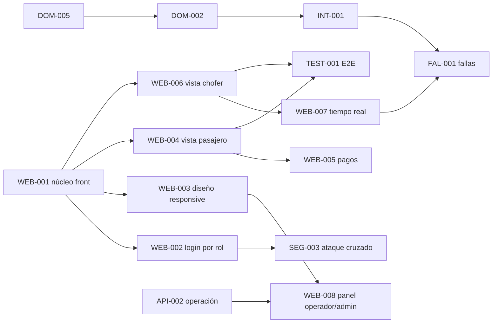

# Sprint 1: front-end por rol, tiempo real, pagos y cierre de evidencias

- **Duración:** 7 días, del martes 3/11 (Día 1) al lunes 9/11 (Día 7).
- **Objetivo:** que un pasajero, un chofer y un operador/administrador puedan usar la plataforma desde la web (login por rol, viaje en vivo y cobro), con evidencia reproducible de carga, fallas y seguridad.
- **Fuera de alcance:** deploy online, login propio (la autenticación sigue siendo externa, AGENTS.md), cambios de contrato sin pasar por `docs/api.md`.
- **Regla de compatibilidad:** toda tarea que cambie endpoints o eventos actualiza primero `docs/api.md` / `docs/contratos.md`.

## Responsables y flujos

| Persona | Flujo | Enfoque del sprint |
|---|---|---|
| **Fabio** | C | Núcleo del front, login por rol, sistema de diseño responsive, panel Operador/Admin, endpoints de operación, seguridad y E2E. |
| **Joel** | A | Cierre del núcleo de viajes (carreras, estados, integración) y experiencia del pasajero con pagos. |
| **Valentino** | B | Experiencia del chofer, seguimiento en vivo por WebSocket, mediciones y pruebas de falla. |

## Tareas por persona

| ID | Tarea | Responsable | Días | Depende de | Issue |
|---|---|---|---|---|---|
| WEB-001 | Núcleo del front: shell, router, cliente API, sesión (ADR 0055) | Fabio | 1 | nada | #39 |
| OPS-004 | Nginx sirve el front desde el gateway | Fabio | 1-2 | nada | #40 |
| WEB-002 | Login por rol con el emulador de identidad | Fabio | 1-2 | WEB-001 | #41 |
| WEB-003 | Sistema de diseño responsive y accesibilidad | Fabio | 2-3 | WEB-001 | #42 |
| API-002 | Endpoints de Operador/Admin | Fabio | 2-4 | nada | #43 |
| WEB-008 | Panel Operador/Admin | Fabio | 4-6 | WEB-003, API-002 | #44 |
| SEG-003 | Entorno para ataque cruzado y hardening del front | Fabio | 5-7 | WEB-002 | #45 |
| TEST-001 | E2E Playwright por rol y viewports | Fabio | 5-7 | WEB-004, WEB-006 | #46 |
| ARC-006 | Cerrar límites de microservicios y autenticación externa | Fabio | 6-7 | nada | #23 |
| DOM-005 | Carrera entre recálculo y confirmación | Joel | 1-2 | nada | #14 |
| DOM-002 | Estados y transiciones del viaje | Joel | 2-3 | DOM-005 | #16 |
| INT-001 | Integración tarifas, viajes y flota | Joel | 3-4 | DOM-002 | #26 |
| WEB-004 | Vista del pasajero (variante A visible) | Joel | 2-5 | WEB-001 | #47 |
| WEB-005 | Pagos: estado, recibo, falla y reintento | Joel | 5-6 | WEB-004 | #48 |
| WEB-006 | Vista del chofer: disponibilidad, ofertas y viaje | Valentino | 1-4 | WEB-001 | #49 |
| WEB-007 | Seguimiento en vivo con WebSocket y reconexión | Valentino | 3-5 | WEB-006 | #50 |
| MED-002 | Mediciones finales (3 repeticiones por escenario) | Valentino | 3-6 | nada | #51 |
| FAL-001 | Pruebas de falla de dependencias | Valentino | 6-7 | INT-001, WEB-007 | #52 |
| ARC-001 | Cerrar ADR de módulos CommonJS/ESM | Valentino | 7 | nada | #17 |
| DOC-001 | Informe, guion de demo y verificación de clon limpio | Los tres (lidera Joel) | 7 | todo | #53 |

## Cronograma

| Día | Fabio | Joel | Valentino |
|---|---|---|---|
| 1 (mar 3) | **WEB-001** (se integra a `main` al final del día), OPS-004 | DOM-005 | WEB-006 (con datos simulados hasta que llegue WEB-001) |
| 2 (mié 4) | WEB-002, WEB-003, API-002 | DOM-005 (cierre), DOM-002, WEB-004 | WEB-006 |
| 3 (jue 5) | WEB-003, API-002 | DOM-002, INT-001, WEB-004 | WEB-006, WEB-007, MED-002 |
| 4 (vie 6) | API-002, WEB-008 | INT-001, WEB-004 | WEB-006 (cierre), WEB-007, MED-002 |
| 5 (sáb 7) | WEB-008, SEG-003, TEST-001 | WEB-004 (cierre), WEB-005 | WEB-007 (cierre), MED-002 |
| 6 (dom 8) | WEB-008 (cierre), SEG-003, TEST-001, ARC-006 | WEB-005 (cierre) | MED-002 (cierre), FAL-001 |
| 7 (lun 9) | TEST-001, ARC-006, DOC-001 | DOC-001 (líder) | FAL-001, ARC-001, DOC-001 |

## Dependencias

El único cuello de botella es **WEB-001**: debe estar en `main` al final del Día 1. Hasta entonces, Joel y Valentino trabajan sus vistas contra respuestas simuladas definidas en `docs/api.md`, y no esperan a Fabio.

## Cómo evitar colisiones

Cada persona escribe solo en su carpeta. Si necesita tocar un archivo ajeno, lo pide en el issue correspondiente antes de editarlo.

| Zona | Dueño |
|---|---|
| `web/nucleo/` (router, sesión, cliente API, estilos base) | Fabio |
| `web/vistas/admin/` y `web/vistas/operador/` | Fabio |
| `web/vistas/pasajero/` | Joel |
| `web/vistas/chofer/` y `web/componentes/seguimiento/` | Valentino |
| `src/ms-viajes/dominio.ts`, `postgres.ts`, `http.ts` | Joel |
| `src/ms-viajes/http-operacion.ts` (router nuevo de API-002) | Fabio |
| `src/ms-viajes/tiempo-real.ts`, `src/ms-flota/*`, `carga/*` | Valentino |
| `nginx.conf`, `docker-compose.yml`, `src/emulador-auth/*` | Fabio |
| `docs/mediciones.md` | Valentino |
| `docs/ataque.md` | Fabio |

Rangos de ADR: Flujo A 0033-0039, Flujo B 0040-0049, Flujo C 0050-0059 (el ADR del front es el 0055).

## Hitos de integración

- **Fin del Día 1:** WEB-001 en `main`; todos hacen `git pull` y rebasan.
- **Fin del Día 3:** login por rol funcionando y estilos base publicados; DOM-002 cerrado.
- **Fin del Día 5:** viaje completo visible en vivo (pasajero y chofer) y E2E del flujo feliz en verde.
- **Fin del Día 6:** pagos, panel de operación y mediciones listos; se congela el alcance.
- **Día 7:** solo corrección de defectos, informe y ensayo de la demo.

## Definition of Done del sprint

- `npm.cmd test` pasa al 100% y `npm.cmd run test:pw` cubre los tres roles.
- El flujo completo funciona desde un clon limpio con Docker Compose (verificado por alguien distinto al autor).
- Cada pantalla se ve bien en 360 px, 768 px y 1024 px.
- Tokens, roles y precio congelado se validan en el backend, no en la interfaz.
- `docs/api.md`, `docs/contratos.md`, `docs/mediciones.md` y `docs/backlog.md` están sincronizados con el código.
- Cada issue se cierra por PR con `Closes #N`, siguiendo la skill `flujo-git-github`.

## Riesgos

| Riesgo | Mitigación |
|---|---|
| WEB-001 se atrasa y bloquea las vistas | Vistas contra datos simulados; WEB-001 se reduce al mínimo (router, sesión, cliente API). |
| Conflictos en `web/` | Carpetas por dueño (tabla anterior). |
| Cambio de contrato a mitad del sprint | `docs/api.md` primero y aviso en el issue afectado. |
| Mediciones inestables en máquinas distintas | Registrar entorno y SHA por corrida; ejecutar siempre en la misma máquina. |
| Retrasos de integración | Hitos diarios y congelamiento de alcance el Día 6. |
